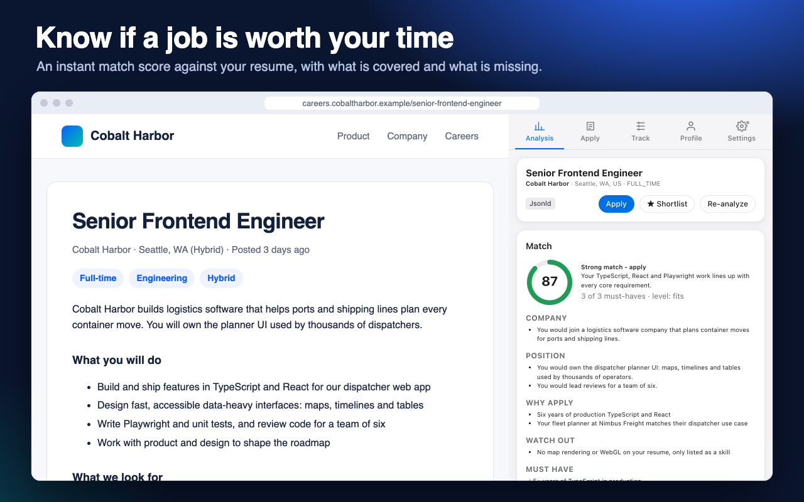
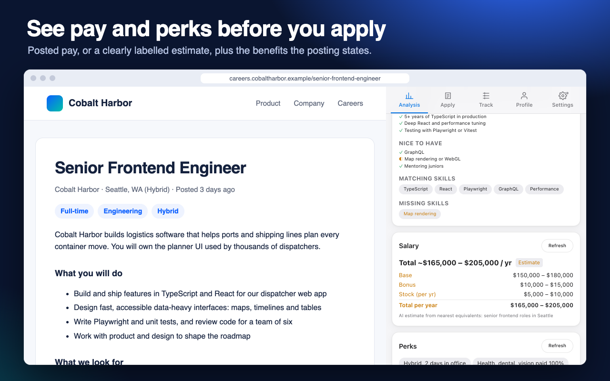
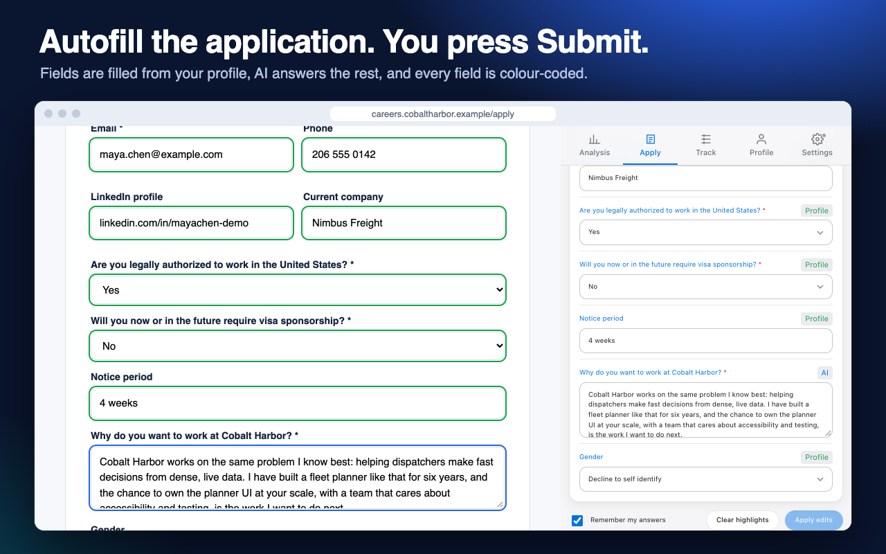
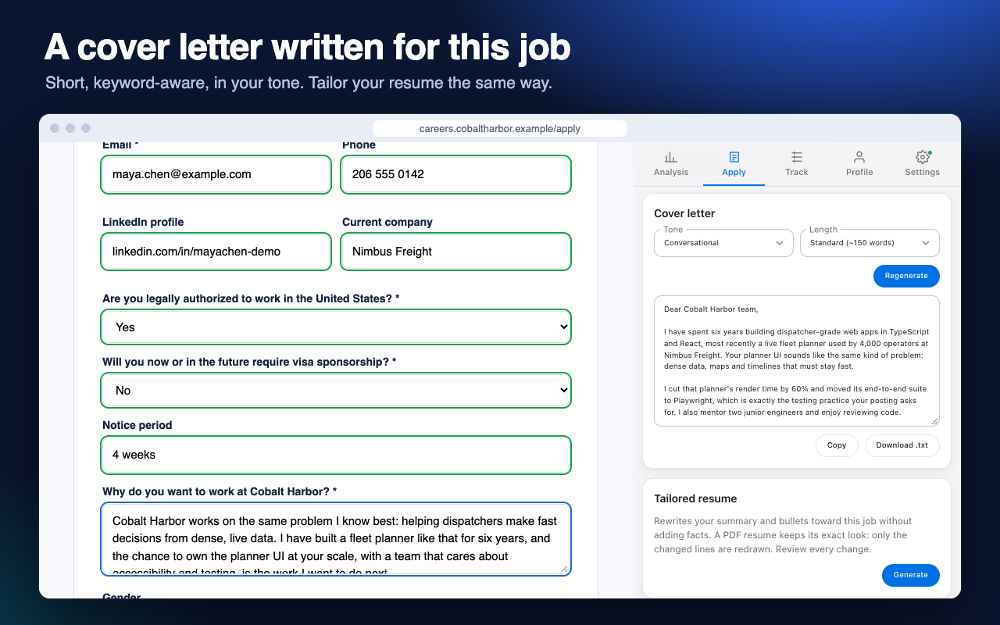
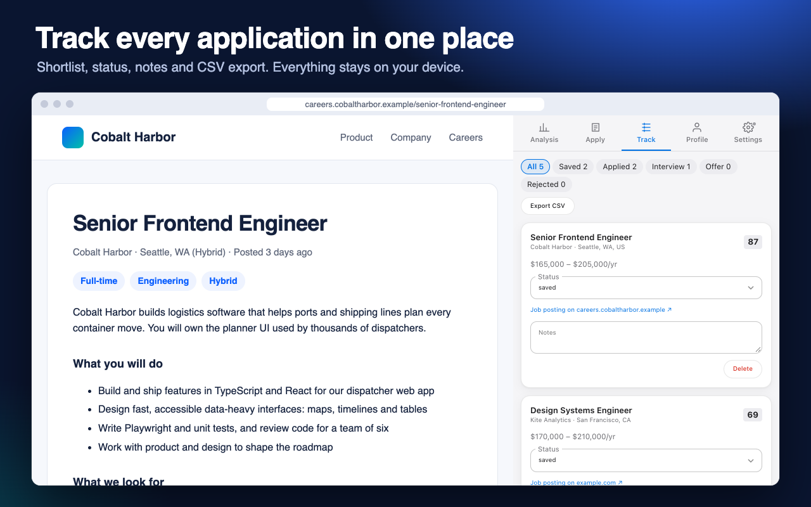
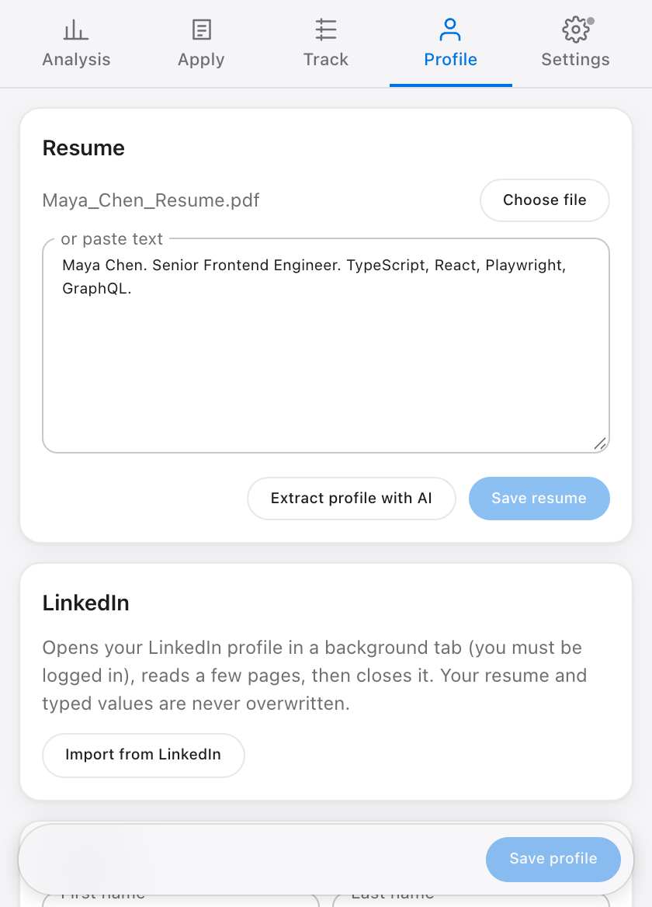
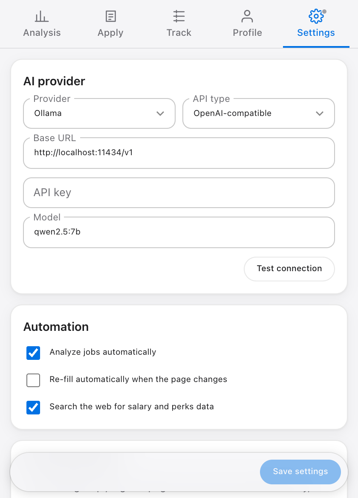

<p align="center"></p>

<h1 align="center">Smart Job</h1>

<p align="center"><b>An AI sidekick for your job search and apply.</b><br>
SmartJob is a Chrome side panel that scores every job against your resume, shows pay and perks, and fills in the application. It never submits for you.</p>

<p align="center">
  <a href="marketing/smartjob-launch-16x9.mp4"></a><br>
  <sub>Click to watch the 40 second launch video. All screens use a fictional candidate and company.</sub>
</p>

## What it does

Keep the panel open while you browse LinkedIn, Indeed, Workday, Greenhouse, Lever, iCIMS and similar sites.

### Know if a job is worth your time

The **Analysis** tab detects the job you are viewing, summarizes it, and scores your match against your resume: an AI score checked requirement by requirement, plus a deterministic keyword score. Shortlist the good ones with one click.


### See pay and perks before you apply

Posted pay when the listing has it. Otherwise a web search, then an AI estimate from the nearest equivalents, always labelled **Estimate**. Perks come from the posting.



### Autofill the application

The **Apply** tab fills forms in every frame (iCIMS iframes included). Rules handle the standard fields, AI answers the leftover questions, and your saved answers are reused. Filled fields are outlined: **green** = profile, **blue** = AI, **amber** = needs review. **It never submits.**



### Write for each job

A short, keyword-aware cover letter. A tailored resume that keeps your PDF's exact look and redraws only the changed lines (side-by-side preview, download as PDF). An answer box for any application question.



### Track every application

Shortlisted and applied jobs with status, notes, saved resumes and CSV export.



### Also

- **LinkedIn import**: Settings → Import / Refresh from LinkedIn reads your own profile, skills, certifications and recent posts (you must be logged in) and adds them to your profile for matching and writing.
- **Setup wizard**: on first open it walks through the AI provider, your resume and/or LinkedIn profile, a profile review, and suggested roles. Each role becomes a LinkedIn job search.
- **Settings**: AI provider, resume upload (PDF/TXT), AI profile extraction, full profile editor, answer bank, export/import.

<p>
  
  
</p>

## Your data stays with you

Everything is stored locally in `chrome.storage.local`. Data leaves the machine only for calls to the AI endpoint you choose and for the salary web search. Use a local model (Ollama, LM Studio) and nothing goes to a cloud AI at all.

See [PLAN.md](PLAN.md) for the product requirements, research and architecture.

## Install (developer mode)

```bash
bun install
bun run build          # outputs dist/
```

1. Open `chrome://extensions`, turn on **Developer mode**.
2. **Load unpacked** → select the `dist/` folder.
3. Pin SmartJob, click its toolbar icon → the side panel opens.

After code changes: `bun run build`, then click the reload icon on the extension card and reopen the panel.

**Refresh any job or application tab that was already open** when you install or reload the extension. Chrome only injects the content script into pages loaded afterwards; without a refresh the panel shows "no job" and Fill does nothing.

## Configure AI

Settings tab → pick a preset → **Test connection** → **Save settings**.

| Preset | Base URL | Notes |
|---|---|---|
| Ollama | `http://localhost:11434/v1` | Run `ollama pull qwen2.5:7b` (or any ≥4B instruct model). |
| LM Studio | `http://localhost:1234/v1` | Load a model, start the server. Tested: `qwen3.6-35b-a3b-splash` is fast (~15 s per call) and good. `qwen3.5-4b-mlx` works but takes minutes per call. |
| OpenAI / OpenRouter | cloud | Paste API key. |
| Anthropic | `https://api.anthropic.com` | Paste API key; default model `claude-opus-5-5` (uses server-side fallback on refusals). |

Ollama rejects browser-extension origins by default (HTTP 403). SmartJob strips the `Origin` header from its own requests to `localhost:11434`, so no `OLLAMA_ORIGINS` setup is needed. The rule applies only to requests this extension makes.

Small local models (<4B) produce weak analysis; ≥7B local or any cloud model is recommended. Form filling mostly does not need AI: the standard fields are filled by deterministic rules.

## First run

On first open, a setup wizard walks through the AI provider, your resume and/or LinkedIn profile, a review of the profile, and suggested roles. Each role you pick becomes a LinkedIn job search that you can reopen from the Job tab. The steps below are the same thing done by hand in Settings.

1. Settings → upload your resume PDF (or paste text) → **Save resume** → **Extract profile with AI**.
2. Review the profile, then fill in what a resume does not contain: work authorization, sponsorship, relocation, current salary / CTC, salary expectation, notice period. Leave the EEO fields blank to have SmartJob choose "decline to answer".
3. Save.
4. Optional: Settings → **Job-site account email / password**. On Workday / iCIMS "Create Account" or sign-in pages, **Fill this page** fills email, password and confirm password. You click Create Account. The password stays on this device and is never sent to the AI. Workday requires an uppercase letter, a number and a special character.

## Test walkthrough (manual)

1. **Job analysis**: open a LinkedIn job (`linkedin.com/jobs/view/...` or the search split view). The Job tab shows the job, then the match and salary. Click another job in the list; the panel follows.
2. **Shortlist**: click ★ Shortlist → the job appears in the Tracker.
3. **Autofill**: open a Greenhouse (`job-boards.greenhouse.io/...`), Lever (`jobs.lever.co/.../apply`), Workday (`*.myworkdayjobs.com`, after signing in) or iCIMS application form → Apply tab → **Fill this page**. Review the amber items, edit them in the panel, and click **Apply edits** (tick *Remember my answers* to reuse them later). On Workday, click **Next** yourself, then **Fill this page** again, or turn on *Auto-fill when the page changes* in Settings.
4. **Writing**: Write tab → generate a cover letter / tailored resume → Copy, or open the printable PDF.

## Automated tests

```bash
bun run test                     # unit tests (mapping, scanner, extraction, AI normalization, salary parsing)
bun run test:e2e                 # Playwright + bundled Chromium, loads dist/ against HTML fixtures (Workday-like, iCIMS iframe, Greenhouse, Lever, LinkedIn)
bun run build && bun test/live/realsites.ts   # real public Greenhouse + Lever forms, prints every field and its filled value (never submits)
bun test/live/ai.live.ts         # every AI task against LM Studio at localhost:1234
bun test/live/realjobs.ts        # job extraction on real LinkedIn / Workday / Greenhouse / Lever pages
bun test/live/checks.ts          # PDF resume parsing, Anthropic path, salary search from the extension
bun test/live/storeshots.ts       # regenerates docs/screenshots and the Chrome Web Store images in store/ (fictional persona)
```

## What was verified, and how

| Area | Live sites | Fixtures only |
|---|---|---|
| Job extraction | LinkedIn (logged-out view), Workday job page (NVIDIA), Greenhouse, Lever | LinkedIn logged-in split view, Indeed, iCIMS, Ashby, SmartRecruiters |
| Autofill | Lever (Palantir), Greenhouse (Anthropic, GitLab, Reddit), Ashby (Ramp). Every profile-mappable field was filled with none wrong; AI answered the essay questions using qwen3.6-35b-a3b | Workday (multi-step, custom dropdowns, multiselect, date sections), iCIMS (iframe) |
| AI tasks | LM Studio qwen3.5-4b and qwen3.6-35b-a3b; Anthropic request path (reaches the API) | — |

If Workday or iCIMS misbehaves: Apply tab → **Copy field scan (for bug reports)** copies every detected field (label, type, `data-automation-id`, options) as JSON. Paste that into the bug report.

## Known limits

- Real Workday and iCIMS application pages need an account, so they were tested against fixtures modelled on their markup, not live. If a field stays amber, it was not filled.
- LinkedIn logged-in pages (2026 UI: `/jobs/search-results/` and `/jobs/view/`) were tested live. LinkedIn uses hashed class names, so a redesign can break detection again.
- Salary web search: search engines and salary sites (Bing, DuckDuckGo, levels.fyi, Glassdoor) serve captchas or junk results to automated requests. SmartJob filters out results that don't mention pay. When nothing usable remains, it shows an AI estimate labelled **Estimate**, plus links to Levels.fyi and Glassdoor.
- Comboboxes such as react-select don't list their options until opened. AI answers for them are matched against the menu when it opens.
- File upload attaches your stored resume to file inputs. Some sites parse the upload and overwrite fields, so upload first and then fill again.
- DOCX resumes are not parsed yet; use PDF or paste the text.
- Shadow-DOM fields are not scanned.
